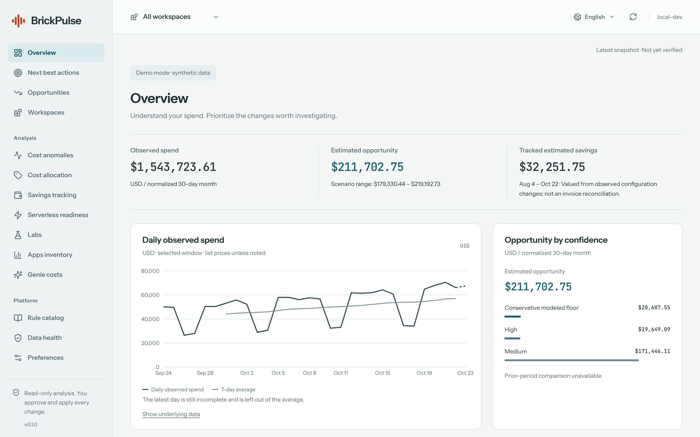
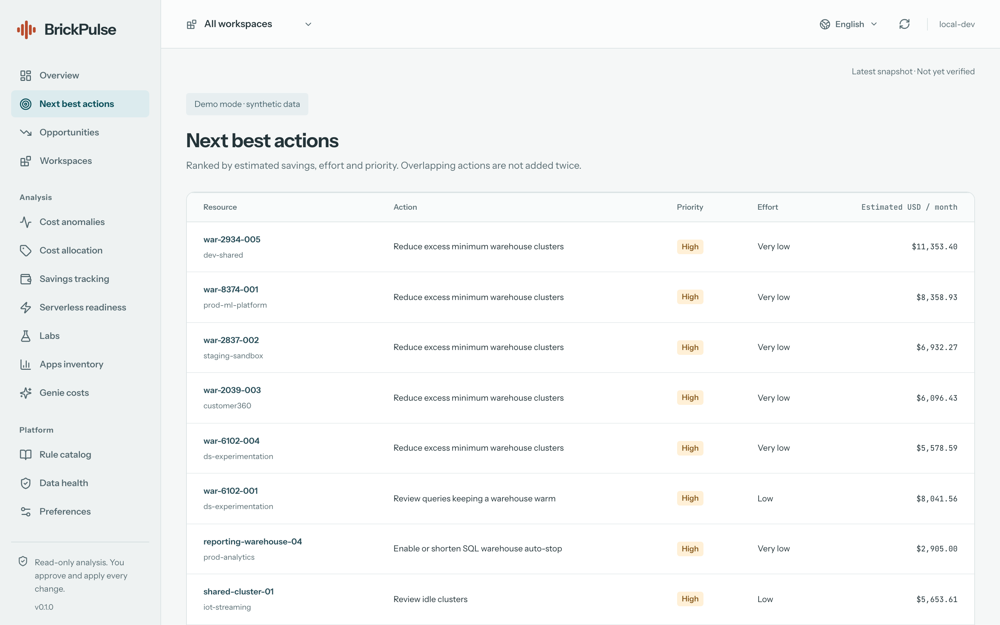

<p align="center">
  <picture>
    <source media="(prefers-color-scheme: dark)" srcset="docs/brand/brickpulse-lockup-color-dark.svg">
    
  </picture>
</p>

<p align="center">
  <strong>FinOps de solo lectura y guiado por evidencia para Databricks.</strong><br>
  Desde el gasto a nivel de cuenta hasta la evidencia detrás de cada oportunidad de ahorro.
</p>

<p align="center">
  <a href="https://github.com/pedrotramos/BrickPulse/actions/workflows/ci.yml"></a>
  <a href="LICENSE"></a>
  
  
</p>

<p align="center">
  <a href="README.md">English</a> · <b>Español</b> · <a href="README.pt-BR.md">Português</a>
</p>

> *Traducido de la versión en inglés. Si hay diferencias, la versión en inglés es la referencia.*

---

BrickPulse es una [Databricks App](https://docs.databricks.com/dev-tools/databricks-apps/) que lee las
system tables de la cuenta, detecta dónde se desperdicia dinero y explica cada hallazgo con la evidencia,
el esfuerzo necesario y un rango de ahorro. Es **orientativo y de solo lectura**: nunca modifica los
recursos que analiza.

<p align="center">
  
</p>

<details>
<summary>Más capturas de pantalla</summary>



</details>

## Qué hace

- **Resumen de gasto.** Gasto observado por workspace, día y SKU, para los workspaces de la región del
  metastore.
- **42 reglas de costo.** Las reglas cubren clústeres, SQL warehouses, jobs, pipelines, model serving,
  inferencia de IA, almacenamiento y gobernanza. Cada hallazgo incluye evidencia, un rango de estimación,
  una guía paso a paso y un enlace al recurso en Databricks.
- **Próximas acciones.** Los hallazgos se ordenan por ahorro estimado, esfuerzo y prioridad. Cuando varias
  opciones se superponen sobre el mismo recurso, se agrupan en lugar de sumarse.
- **Análisis.** Anomalías de costos, asignación de costos basada en etiquetas y preparación para serverless.
- **Seguimiento de ahorros.** El ahorro se estima a partir de los cambios que BrickPulse observa después de
  una recomendación. Son estimaciones, no una conciliación de facturas.
- **Precios contractuales (opcional).** Estimaciones adicionales a partir de
  `system.billing.account_prices` que reflejan descuentos negociados. El precio de lista sigue siendo la
  base comparable.
- **Superficies opcionales.** Un inventario de Apps, costos de Genie y un panel *Preguntar a Genie* (Ask
  Genie). Las tres están desactivadas por defecto.
- **Tres idiomas.** La interfaz está disponible en inglés, español y portugués de Brasil. Detecta el idioma
  del navegador, recuerda una elección explícita y, si no hay coincidencia, usa inglés. Los importes siempre
  están en USD.

## Principios de diseño

- **Cada número se explica a sí mismo.** Cada cifra muestra su período, fuente, confianza y actualidad.
- **Lo desconocido no es cero.** Los datos faltantes nunca se muestran como gasto cero ni como "sin
  oportunidades".
- **El idioma no cambia las cuentas.** El scoring, el ranking y los importes no dependen del idioma de la
  interfaz.
- **Recomendar, nunca actuar.** BrickPulse no tiene ninguna vía de escritura hacia los recursos que analiza.
- **Mínimo privilegio.** Al service principal de la app se le concede `SELECT` tabla por tabla, nunca sobre
  un esquema completo. Al principio, solo la persona que la instaló puede abrir la app.

## Inicio rápido (demo local)

Se puede probar la interfaz completa con datos sintéticos, sin un workspace de Databricks. Se necesitan
Python 3.10+, Node 20.19+ y npm.

```sh
git clone https://github.com/pedrotramos/BrickPulse.git && cd BrickPulse
python3 -m venv .venv && .venv/bin/python -m pip install -e '.[dev]'
npm --prefix frontend ci
npm run dev        # luego abrir http://127.0.0.1:5173
```

Los datos de demostración están claramente identificados en la interfaz y nunca tocan un workspace real.
Ver la [guía de primeros pasos](docs/es/getting-started.md) para más detalles.

## Desplegar en un workspace

BrickPulse se distribuye como un
[Declarative Automation Bundle](https://docs.databricks.com/dev-tools/bundles/) (paquete de automatización
declarativa). Contiene la app, un pipeline serverless y un job de actualización diaria. Un solo comando
verifica los accesos, despliega todo, ejecuta la primera actualización e inicia la app:

```sh
.venv/bin/python scripts/deploy.py --profile <PROFILE> --target prod \
  --catalog <CATALOG> --warehouse-id <WAREHOUSE_ID>
```

Leer la [guía de despliegue](docs/es/deployment.md) para ver los requisitos previos, los permisos sobre las
system tables, las actualizaciones y la desinstalación.

## Documentación

| Guía | |
| --- | --- |
| [Primeros pasos](docs/es/getting-started.md) | Configuración local, modo demo, ejecución de las pruebas |
| [Despliegue](docs/es/deployment.md) | Instalación en un workspace, actualizaciones, `dev` vs `prod`, desinstalación |
| [Configuración](docs/es/configuration.md) | Modo de precios, pestañas opcionales, variables de entorno, umbrales de las reglas |
| [Seguridad](docs/es/security.md) | Identidades, alcance por usuario, dar acceso a más personas |
| [Solución de problemas](docs/es/troubleshooting.md) | Permisos faltantes, datos vacíos, reglas desactivadas |

Referencias para colaboradores (en inglés): [Architecture](docs/ARCHITECTURE.md),
[Data model](docs/DATA_MODEL.md), [Savings confidence model](docs/SAVINGS_CONFIDENCE_MODEL.md),
[Adding a rule](docs/ADDING_A_RULE.md), [Testing](docs/TESTING.md), [Design system](docs/DESIGN.md).
El índice completo está en [docs/](docs/README.md).

## Estructura del proyecto

```text
frontend/src/        React app: app shell, features, components, lib, locales (en, es, pt-BR)
src/brickpulse/
  server/            FastAPI: API, identity, data sources, services, i18n, compiled UI (static/)
  rules/             42 rule plugins, Jinja SQL templates and thresholds
  pipelines/         Lakeflow precompute pipeline, change tracker and DDL
resources/           Bundle resources: app, pipeline, daily job (see databricks.yml)
scripts/             Dev server, deploy, wheel build, regression baseline
tests/               Python test suite and the frozen financial baseline
docs/                User guides (en, es, pt-BR) and contributor references
```

## Contribuir

Las contribuciones son bienvenidas, ya sean nuevas reglas, correcciones, traducciones o documentación.
Leer [CONTRIBUTING.md](CONTRIBUTING.md) (en inglés) para empezar, y seguir el
[Código de conducta](CODE_OF_CONDUCT.md) (en inglés). Reportar los problemas de seguridad en privado, tal
como se describe en [SECURITY.md](SECURITY.md) (en inglés).

## Licencia

[Apache License 2.0](LICENSE) (en inglés). Ver [NOTICE](NOTICE) (en inglés) para las atribuciones de
terceros.

BrickPulse es un proyecto independiente de código abierto. No está afiliado, respaldado ni patrocinado por
Databricks, Inc. «Databricks» es una marca comercial de Databricks, Inc.
